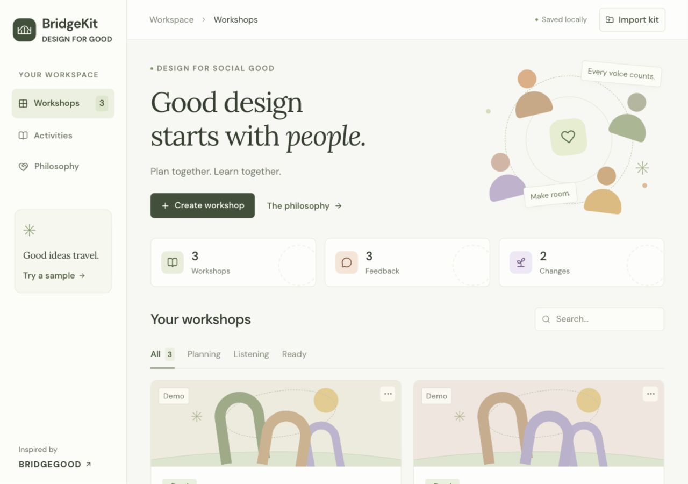
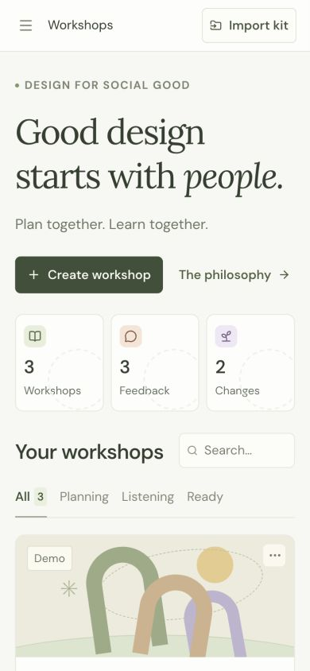

# BridgeKit

**Good design starts with people.**

BridgeKit helps facilitators plan community design workshops, respond to participant feedback, and pass what they learn to the next facilitator. It turns BRIDGEGOOD’s **Design for Social Good** philosophy into editable activities, visible decisions, and reusable workshop kits.

[](https://github.com/KuanL1u/bridgekit/actions/workflows/ci.yml)



*The screenshots and included workshop examples use synthetic demo data.*

<details>
<summary>See the mobile workspace</summary>



</details>

## Why BridgeKit

A workshop plan becomes more useful when it responds to the people in the room. The next facilitator also needs to understand **why** an activity changed.

BridgeKit keeps that learning with the plan. Each activity includes instructions, conversation prompts, another way to participate, its reasoning, and source references. A facilitator can adapt an activity after feedback or explain why they are keeping it. Earlier versions remain available.

For example, the sample workshop starts with a digital idea board. A synthetic reflection raises a phone-data barrier. The facilitator can switch to a **Paper-first idea studio**, record the reason, and share the revised kit with the original plan preserved.

Built for the hackathon challenge to [scale BRIDGEGOOD’s Design for Social Good philosophy and mindset](https://hackforsocialimpact.notion.site/Scale-BRIDGEGOOD-s-Design-for-Social-Good-philosophy-and-mindset-3f62cb772f1e80f5aed7e0b2626e8bb5).

## The experience

| Step | What the facilitator does |
| --- | --- |
| **1. Community** | Describe the group, purpose, available time, materials, languages, and participation considerations. |
| **2. Plan** | Start with a timed agenda, explore each activity’s reasoning, and edit, reorder, add, or remove activities. |
| **3. Listen** | Capture optional reflections, respond to barriers or ideas, and record an adaptation or a reason to keep the approach. |
| **4. Share** | Review changes and version history, prepare a handoff, and download or print a kit for another facilitator. |

The workspace also includes:

- A searchable workshop dashboard with status filters and duplication.
- A library of **eight draft activities** with source attribution and participation alternatives.
- A starting agenda that uses paper activities when personal devices or reliable internet are unavailable, adds quiet reflection when requested, and leaves time between activities.
- A philosophy guide connecting the activities to listening, agency, access, and community feedback.
- Browser autosave, validated kit imports, and recovery handling for malformed saved data.
- Responsive layouts, labelled controls, visible keyboard focus, and focus management for dialogs and mobile navigation.

## Quick start

**Requirements:** Node.js **24** and npm. An `.nvmrc` is included for developers who use nvm.

```sh
git clone https://github.com/KuanL1u/bridgekit.git
cd bridgekit
npm ci
npm run dev
```

Open the address printed by Vite. The development server binds to `127.0.0.1`, usually on port `5173`; it chooses another port if that one is occupied.

The MVP runs entirely in the browser. Setup requires no API keys, database, or account configuration.

### Commands

| Command | Purpose |
| --- | --- |
| `npm run dev` | Start the local development server. |
| `npm run build` | Check TypeScript and create the production build in `dist/`. |
| `npm run preview` | Preview an existing production build locally. |
| `npm test` | Run the automated tests once. |
| `npm run test:watch` | Rerun tests while developing. |

To preview a production build:

```sh
npm run build
npm run preview
```

The `dist/` directory can be served by a static host. Navigation uses hash routes, so the host does not need an application-specific route rewrite.

## A three-minute demo

1. Open **A more welcoming campus**, the sample workshop included in a new workspace.
2. Explore **Plan**. Expand an activity to see its instructions, reasoning, sources, and alternative participation format.
3. Go to **Listen** and respond to the synthetic reflection about internet access.
4. Choose **Paper-first idea studio**, explain how it helps the group participate, and save the adaptation.
5. Open **Share**. Compare the original and revised activity, then open **Version history** to inspect the earlier plan.
6. Choose **Download kit** for a portable JSON file, or **Print / PDF** for a facilitator guide.
7. Use **Import kit** to continue the plan as a new workshop.

For an already completed example, import [`examples/campus-workshop.bridgekit.json`](examples/campus-workshop.bridgekit.json). This file was generated and imported through the app during verification. It includes the original plan, a feedback-led revision, and source attribution, with no raw reflection records.

## Data and sharing

| Where | What is included |
| --- | --- |
| **This browser** | Workshop context, editable activities, reflection records, facilitator decisions, version snapshots, and handoff notes. |
| **Downloaded JSON kit** | Context, activities, reasoning, decisions, version history, and attribution. Raw reflection records are excluded. |
| **Printed / PDF kit** | A timed agenda, facilitation instructions, prompts, participation alternatives, reasoning, changes, and source references. Raw reflection records are excluded. |

The handoff note is excluded from exports by default. A facilitator can explicitly include their own group summary. Decision reasons and edited activity text are shared with the kit, so use wording appropriate for the next group and avoid identifying participants.

Workspace data is stored in `localStorage` for the current browser and site address. Download a kit to keep or transfer a plan; clearing site storage removes the local workspace. Kit imports create a new workshop rather than replacing the original. Raw reflections are intentionally not transferred to the receiving browser.

The app uses Google Fonts with system font fallbacks and links to external source materials. Reflection records are not sent to those services.

## Technology and architecture

**React · TypeScript · Vite · Lucide icons · Vitest**

Workshop behavior lives in typed domain functions, separate from the screen components. Planning uses deterministic rules; facilitator judgment drives adaptations. Version snapshots preserve the agenda and community context at each saved stage.

```text
src/
  content.ts             Draft activities, principles, and source references
  types.ts               Workshop, reflection, revision, and version models
  workshops.ts           Planning, decisions, snapshots, import/export, recovery
  workshops.test.ts      Domain and data-handling tests
  App.tsx                Workspace state, persistence, navigation, dashboard
  ContextScreen.tsx       Community context and first-plan creation
  PlanScreen.tsx          Activity editing and ordering
  ReflectScreen.tsx       Reflections and facilitator decisions
  KitScreen.tsx           Handoff, version history, and printable kit
  ResourceScreens.tsx     Activity library and philosophy guide
  ui.tsx                 Shared visual components and focus management
  styles.css             Responsive interface and print layout
examples/
  campus-workshop.bridgekit.json
```

### Verification

The **15 automated tests** cover agenda timing, participation adaptations, independent activity copies, preserved original versions, facilitator decisions, export exclusions, JSON round trips, invalid imports, and storage recovery.

The workflow has also been checked in the browser: creating and adapting a workshop, downloading and importing a kit, persistence after reload, mobile layout, keyboard focus, and the printable guide.

GitHub Actions installs dependencies from the lockfile, runs the tests, and builds the app on pushes and pull requests.

## Current scope and next steps

This is a working hackathon MVP for a facilitator using one browser. Reflections can be collected in person or entered locally; shared participant sessions and remote synchronization remain future work. Language settings provide preparation guidance, while facilitators adapt the English activity text for their group.

The next priorities are:

1. Review the draft activities and adaptations with BRIDGEGOOD.
2. Pilot the complete workshop-to-handoff experience with facilitators and consenting participants.
3. Add community-reviewed translations and more participation formats.
4. Explore shared sessions while preserving optional participation and deliberate control over what gets passed on.

A pilot should evaluate whether another facilitator can use the kit, whether feedback leads to useful decisions, and whether participants feel they have a choice in how they take part. The demo figures are examples, not measured community outcomes.

## Sources and attribution

BridgeKit is inspired by [BRIDGEGOOD](https://bridgegood.com/about) and the [BRIDGEGOOD Hack Pack](https://docs.google.com/document/d/1RK9JY_EJEvHTPLNIVF1-QuuEcHhxa3cfWzgVimuUcnA/edit), particularly its guidance on:

- Community feedback and adaptation.
- Confidence and individual definitions of success.
- Understanding people and asking reflective questions.
- Community voice, accessibility, and consent.

The activities are **draft adaptations created for a hackathon**, not official BRIDGEGOOD program materials. Source references remain attached to activities and exported kits. Keep BRIDGEGOOD’s authorship and the reasoning behind local changes connected to the work as it travels.
