# BridgeKit: your four-minute presentation

**Tell one complete story: a phone-access barrier changes a workshop, and the next facilitator gets the plan and its reason.**

[75-second captioned demo](bridgekit-75s-demo.mp4) · [Timed rehearsal guide](guide.html) · [Printable cue cards](../../output/pdf/bridgekit-four-minute-presentation.pdf)

The spoken script is **355 words**. Aim for a calm delivery around 105-115 words per minute, leaving roughly 40-55 seconds for clicks and pauses. The timed guide advances through seven beats in exactly four minutes.

Screenshots are from the actual app with synthetic sample data. The short demo is a captioned walkthrough edited from those screenshots.

## Run sheet

| Time | Show | Why it matters |
| --- | --- | --- |
| 0:00-0:25 | Frame the challenge | The unit of sharing is a workshop with its reasoning and learning. |
| 0:25-1:00 | Make the reasoning teachable | BRIDGEGOOD's reasoning and attribution are connected to an activity people can practice. |
| 1:00-1:30 | Listen to an access barrier | Community experience becomes the trigger for a facilitator decision. |
| 1:30-2:15 | Make and explain a choice | A human chooses the adaptation and explains why it fits this group. |
| 2:15-2:50 | Show what changed | Learning is visible, and the original remains available. |
| 2:50-3:30 | Carry the learning forward | An actual export/import carries the revised plan and history to a new workshop. |
| 3:30-4:00 | Close with the pilot question | The next milestone is useful independent reuse, evaluated with the community. |

## Prepare before presenting

1. Use a desktop-width window. Start the app with npm run dev and open the address Vite prints.
2. Click Try a sample in the left sidebar. Confirm v1, Ideas in the open, and an open phone-data Barrier in Listen; return to Plan.
3. Keep the sample context unchanged. Selecting Limited internet before rebuilding would start with paper and remove the before/after story.
4. Copy the prepared reason before presenting. Scroll inside the response dialog to reach the reason and Save change.
5. Rehearse download/import once and leave the file picker in Downloads. During the live demo, choose the newest exported kit.
6. After a completed practice, click Try a sample to open an unadapted sample or create one. Confirm v1 before the next run.

Open `guide.html` in your browser for a countdown, the full talk track, click cues, and screenshot choices. It works as a local file. With Vite running, you can also open `/docs/presentation/guide.html` on the same local server.

Keep this reason on your clipboard:

> We're switching to paper and spoken contributions so everyone can take part without a reliable phone or data connection.

## The words and clicks

### 0:00-0:25 | Frame the challenge

**Click / point**

- Begin inside the sample workshop on Plan, with v1 visible.
- Point to Ideas in the open. Keep the opening focused on the challenge.

**Say**

> BRIDGEGOOD's Design for Social Good mindset grows through people, mentorship, and relationships. As the organization scales, that knowledge needs to travel beyond any one person. BridgeKit helps a facilitator practice the philosophy in a workshop, act on feedback, and pass the learning to the next community.

Visual cues: Plan

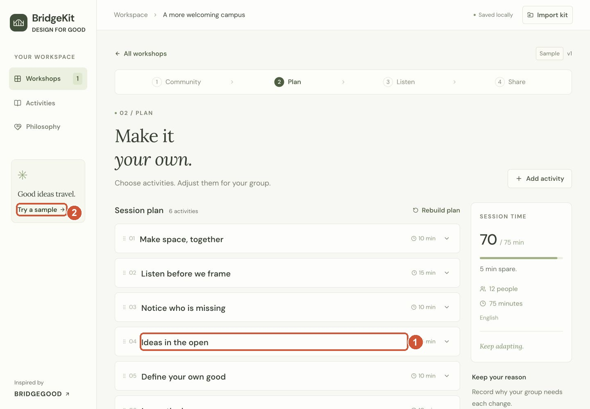

**1.** Expand Ideas in the open · **2.** Try a sample before presenting

### 0:25-1:00 | Make the reasoning teachable

**Click / point**

- Expand Ideas in the open.
- Scroll within the page and open Why it helps and Participation options.
- Point to the reason and Hack Pack source links. Keep source pages for Q&A.

**Say**

> I'm starting with a fictional campus workshop. Each activity carries instructions, the reason behind them, a BRIDGEGOOD source, and another way to participate. The next facilitator can explain why the activity exists, then adapt it for the people in their room. That makes the philosophy practical and teachable.

Visual cues: Plan

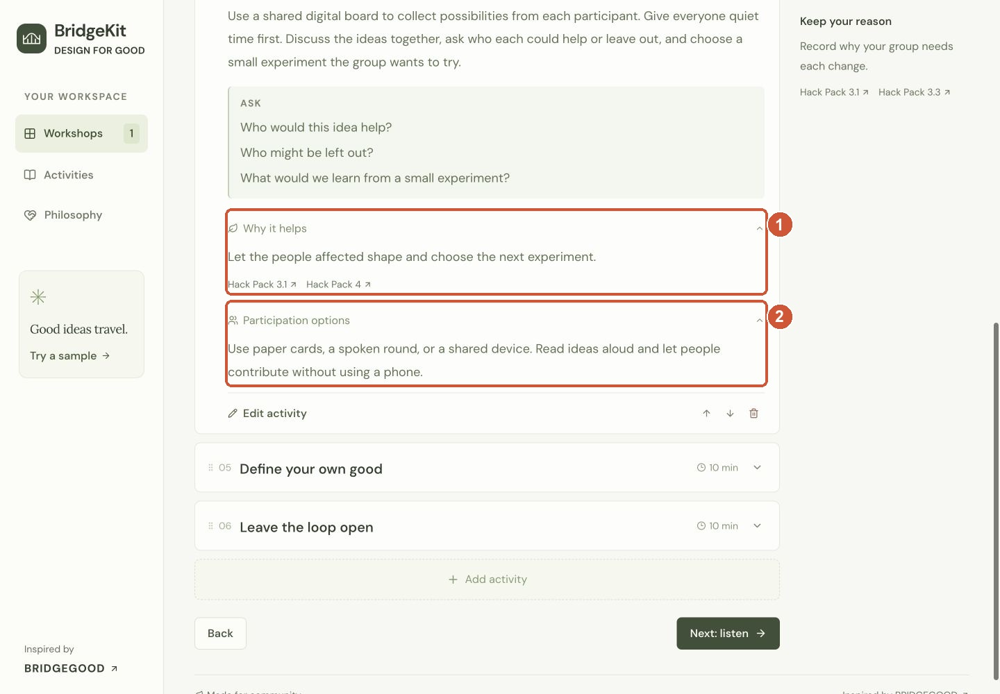

**1.** Reason + BRIDGEGOOD sources · **2.** Another way to participate

**1.** Expand Ideas in the open · **2.** Try a sample before presenting

### 1:00-1:30 | Listen to an access barrier

**Click / point**

- Click Listen in the step bar, or Next: listen.
- Find the first Barrier card about phone or data access.
- Read its observation, then click Respond on that card.

**Say**

> Now let's test the plan against the people using it. This demo feedback says the digital board was hard to join without a reliable phone or data connection. That is a concrete access barrier. I'll respond by deciding what needs to change.

Visual cues: Listen

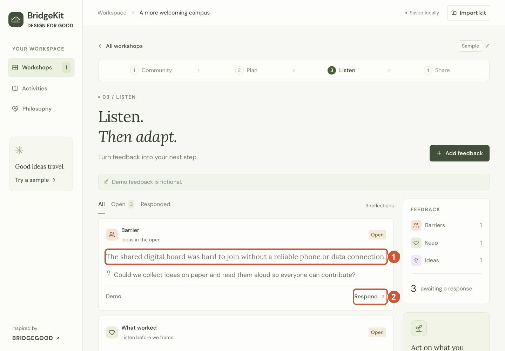

**1.** Listen to the access barrier · **2.** Click Respond

### 1:30-2:15 | Make and explain a choice

**Click / point**

- Review Change activity and Start from: Paper-first idea studio. Both are already selected for this sample barrier.
- Scroll inside the dialog to Why this choice?, and paste the prepared reason.
- Click Save change. Confirm the card now says Adapted.

**Say**

> BridgeKit asks the facilitator to make a choice. I'm choosing Paper-first idea studio, where people can sketch, write, dictate, or speak without a phone. I'll record the reason: we are changing the format so everyone can contribute without reliable phone data. We could also keep an activity and explain why. The facilitator stays in control; the tool preserves the decision and its reasoning.

Visual cues: Respond to feedback

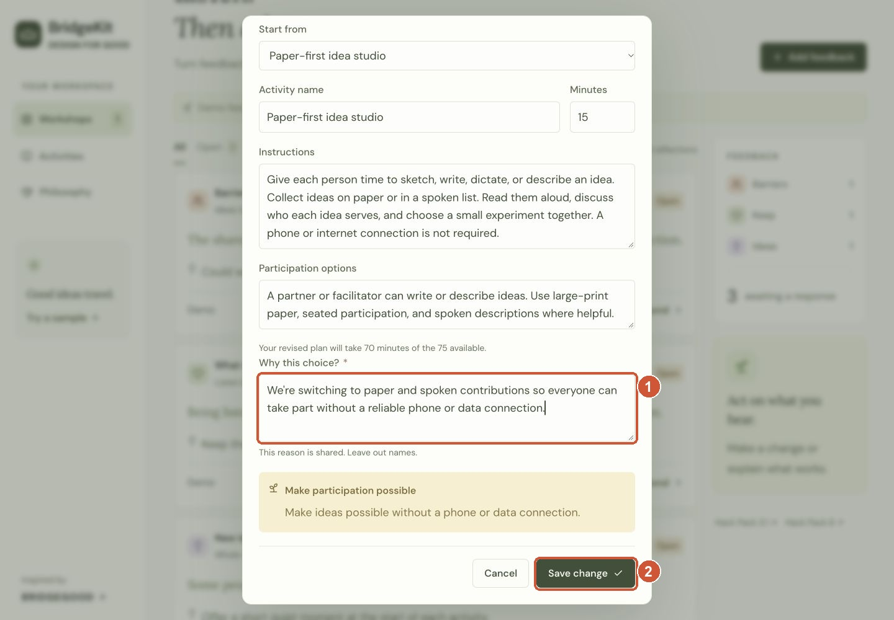

**1.** Explain why this serves the group · **2.** Click Save change

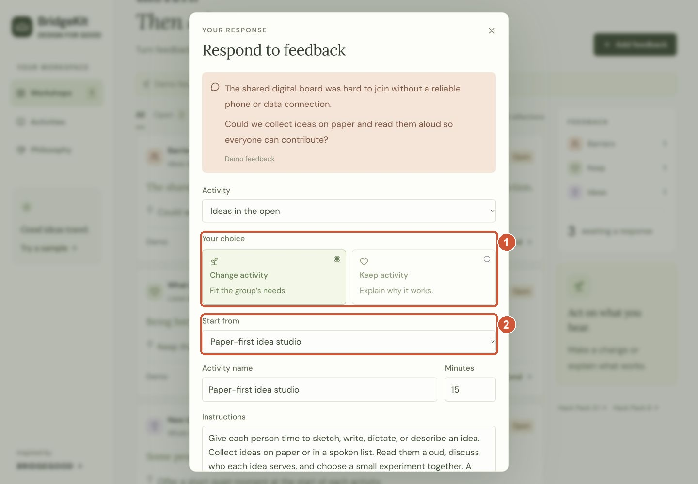

**1.** The facilitator chooses · **2.** Paper-first draft is suggested

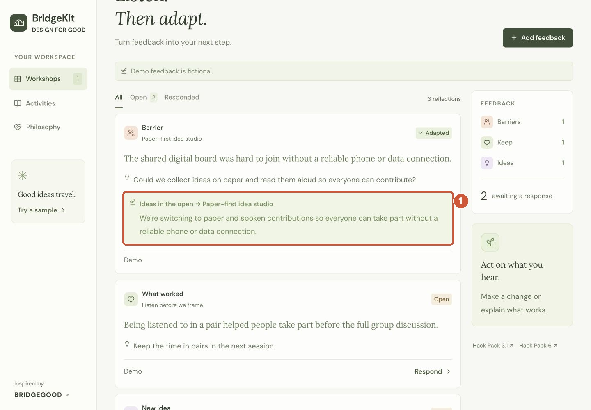

**1.** Feedback changed the activity

### 2:15-2:50 | Show what changed

**Click / point**

- Scroll to the step bar and click Share.
- Scroll to What changed. Point to the original activity, the paper activity, and Why it changed.
- Click Version history; point to v1 Original and v2 Feedback. Close the dialog.

**Say**

> Here is the result: the digital activity becomes a paper activity, and the reason is visible beside the change. Version history keeps the original plan. We are passing on a way to make thoughtful decisions, so the next facilitator can understand the choice and respond to their own group.

Visual cues: Share

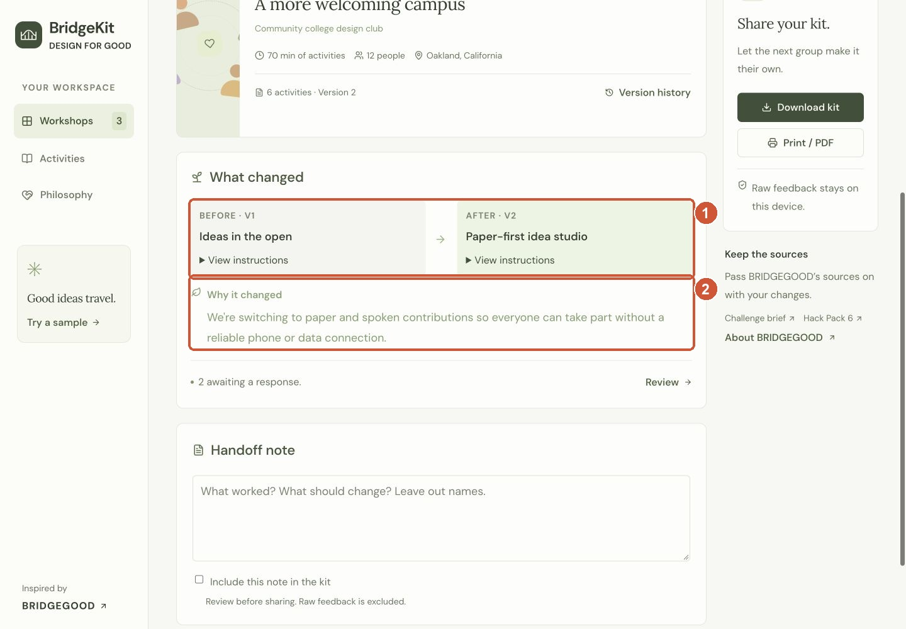

**1.** Original activity → adapted activity · **2.** The reason travels with the change

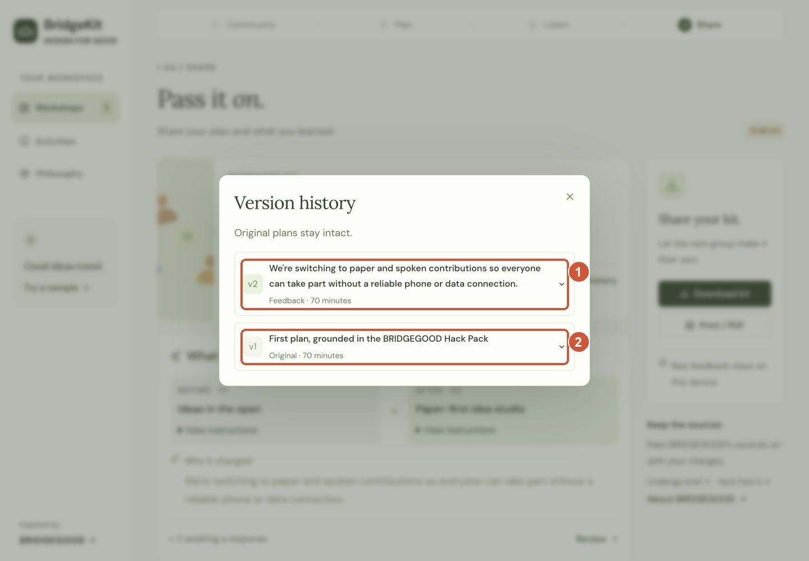

**1.** v2: feedback-led change · **2.** v1: original plan remains available

### 2:50-3:30 | Carry the learning forward

**Click / point**

- Scroll to Share your kit and click Download kit.
- Scroll to the top bar and click Import kit. Select the just-downloaded a-more-welcoming-campus-bridgekit JSON file; duplicate filenames may have a number suffix.
- Confirm the new workshop has Paper-first idea studio and v2. Keep the extra Listen check for Q&A if time is tight.

**Say**

> I'll download the kit and import it as a new workshop, simulating a handoff to another facilitator. The revised activity and its history come with it. Raw feedback is excluded; reasons and edited instructions still need review before sharing. The next community gets a useful starting point and room to make its own choices.

Visual cues: Share, then imported Plan

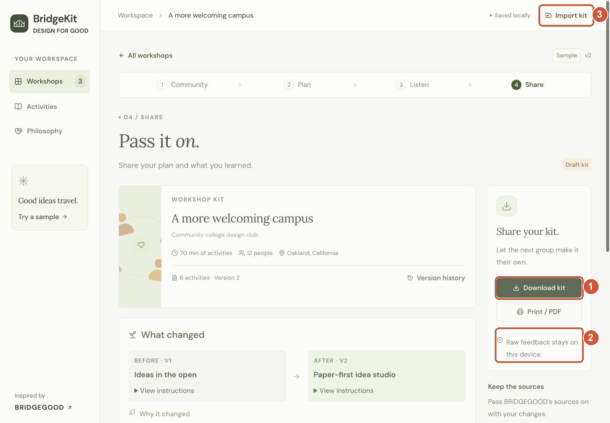

**1.** Download the reusable kit · **2.** Raw feedback stays on this device · **3.** Import it as a new workshop

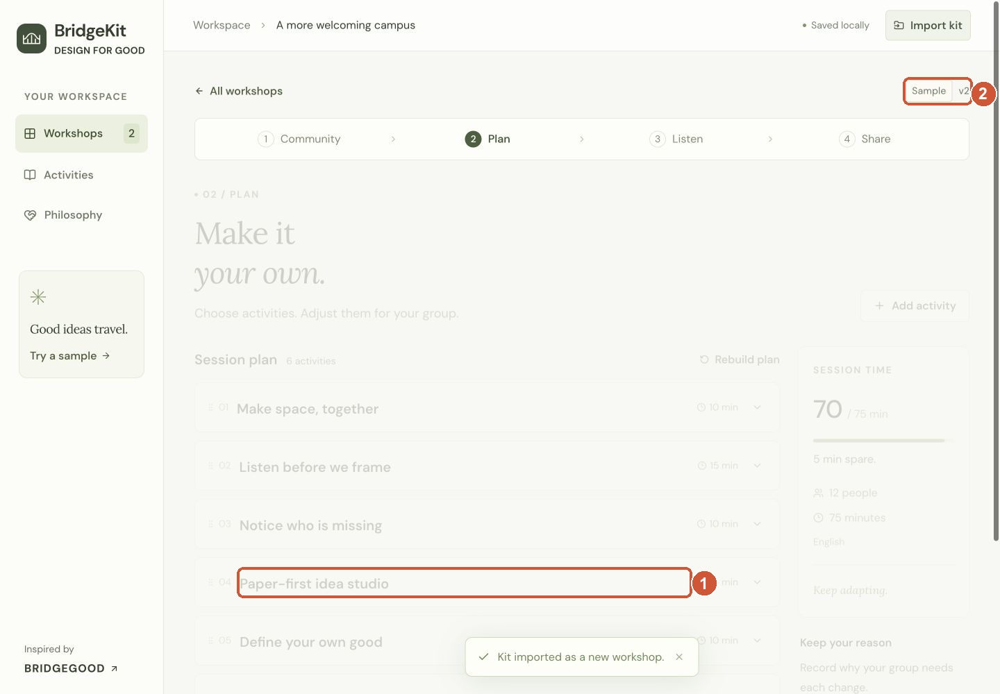

**1.** A new workshop keeps the paper activity · **2.** The version history travels too

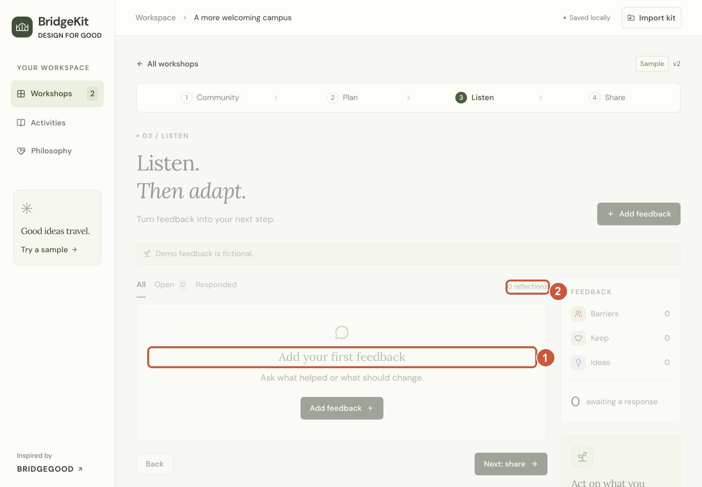

**1.** No raw feedback in the receiving workshop · **2.** 0 reflections after import

### 3:30-4:00 | Close with the pilot question

**Click / point**

- Stop clicking and look at the audience.
- Finish on the imported plan. Emphasize the next facilitator and the pilot.

**Say**

> Our answer to scaling BRIDGEGOOD is to carry the mindset through decisions people can explain and improve. This is a working browser prototype with draft activities. Next, we want BRIDGEGOOD's review and a pilot testing whether a new facilitator can use a kit independently, and whether participants have meaningful ways to take part.

Visual cues: Imported Plan

**1.** A new workshop keeps the paper activity · **2.** The version history travels too

## Keep the ending intact

- At 2:50, move to sharing. The v1/v2 rows are enough; save opening every historical activity for Q&A.
- If the file picker stalls, close it and use the imported-plan screenshot. Say: 'This is the imported example from our rehearsal.'
- At 3:30, stop clicking and deliver the closing. Keep setup, library browsing, print dialogs, and technical details for Q&A.
- Keep the PDF and 75-second captioned demo locally available as backups.

The included [completed demo kit](demo-kit.bridgekit.json) is a backup example. For the live round trip, import the file you just downloaded. If using the prepared example, identify it as a rehearsal capture.

## Judge questions

**Why does this address the challenge?**

It connects BRIDGEGOOD's reasoning to practice, makes feedback decisions explainable, and passes that learning to another facilitator.

**Is there AI or a backend?**

The MVP uses deterministic planning rules and browser localStorage. Facilitators choose adaptations. Accounts, shared sessions, and cloud synchronization are future work.

**What is protected when a kit is shared?**

Raw reflection records are excluded, and handoff notes start excluded. Context, decision reasons, and edited activity text are shared, so facilitators review them before exporting.

**What impact has been measured?**

The current evidence is a working prototype and verified handoff. A pilot should test independent facilitator reuse, useful feedback decisions, and participant choice. Community outcomes have not yet been measured.

**Why are two feedback items still open?**

The four-minute demo completes one decision. The remaining feedback stays visible for review; the kit is an evolving draft.

**Are these official BRIDGEGOOD materials?**

They are draft hackathon adaptations connected to the Hack Pack. BRIDGEGOOD review is a next step.

## What was verified in the code and app

- `generateAgenda` selects paper when devices or internet are limited; the sample intentionally starts with the digital activity.
- `recordDecision` requires a reason, records before/after activities, and preserves the original version.
- `makeKit` removes raw reflections and reflection identifiers; the handoff note starts excluded.
- `parseKit` validates the kit and assigns a new workshop ID.
- The rehearsed UI created the change, exported it, and imported it as a new workshop. The original digital activity, revised paper activity, and two versions survived; the receiving workshop had zero raw reflections.

Relevant code: [workshop domain functions](../../src/workshops.ts), [sample loading and routing](../../src/App.tsx), [feedback decision form](../../src/ReflectScreen.tsx), and [handoff and history](../../src/KitScreen.tsx).

The [BRIDGEGOOD challenge brief](https://hackforsocialimpact.notion.site/Scale-BRIDGEGOOD-s-Design-for-Social-Good-philosophy-and-mindset-3f62cb772f1e80f5aed7e0b2626e8bb5) and [Hack Pack](https://docs.google.com/document/d/1RK9JY_EJEvHTPLNIVF1-QuuEcHhxa3cfWzgVimuUcnA/edit) inform the draft activities and this presentation. Community outcomes remain a pilot question.
